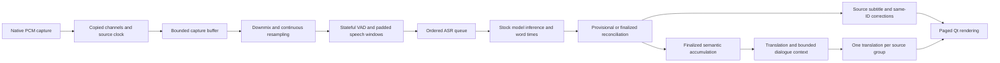

# Transcription and translation accuracy investigation

Date: 2026-10-12. Numeric results, edit counts, runtime versions and fixture hashes are
in [accuracy-evaluation.json](accuracy-evaluation.json). Private audio, model outputs and
traces remain in ignored `build/accuracy/`; they are not part of normal logs or diagnostics.

## Conclusion and scope

The implementation was discarding usable speech, distorting resampled audio, and removing
or repeating recognized words. Those are demonstrated pipeline faults, independent of model
capacity. The repaired pipeline matches whole-file inference on most English stress fixtures
and the Chinese fixture, using the same weights and beam size. It is not yet a guarantee of
whole-file quality in every language: Japanese regressed on the one Japanese sample, Korean
still trails the whole-file control, and overlapping voices remain difficult.

This investigation used source inspection, deterministic signal probes, actual model inference,
controlled context/translation ablations, a repeatable multilingual smoke corpus, and live-speed
replays through the real capture buffer, worker queues, translation and Qt overlay. It did not
substitute a different model to make the results look better. Existing unrelated workspace changes
were preserved. Physical audio-device capture, GPU performance, macOS and a rebuilt frozen
distribution were not validated in this investigation.

## Root causes and supporting evidence

| Finding | Evidence | Repair and accuracy rationale |
|---|---|---|
| Callback-local interpolation lost fractional timing and aliased high frequencies | The original converter rounded every 1,024-frame block independently. At 44.1 kHz the measured accumulated error extrapolated to 4.658 seconds/hour. A 10 kHz input at 48 kHz produced 0.12247 RMS output below the target Nyquist frequency. | Continuous rational-phase Kaiser sinc resampling retains filter history and future samples across callbacks. The same probe now has only -0.274 sample final rounding error over 23.22 seconds and 1.34e-7 RMS alias output. A separate minute-long test bounds sample-count error to one sample. |
| Capture destroyed channel evidence before processing | Stereo was averaged inside the callback. An opposite-polarity stereo fixture became silence, with WER 100% while the intact-channel whole-file control had WER 0%. | Preserve native channels in the capture buffer. Average ordinary stereo, but use an intact strongest channel on severe phase cancellation. The repaired fixture has WER 0%. |
| Energy gating erased quiet speech and short answers | The original absolute RMS floor was 0.008 and minimum speech duration 0.3 seconds. Quiet fixture produced no speech chunks and WER 100%; whole-file recognition had WER 0%. | Stateful bundled Silero VAD, hysteresis, onset padding, and an 80 ms minimum. Limited gain is applied only to detector input; actual ASR samples are unchanged. Quiet fixture now has WER 0%. |
| Pauses and maximum-length limits were treated as final linguistic boundaries | A brief energy dip could end a long phrase after 180 ms. Forced windows retained only 200 ms overlap, and every result was authoritative. Actual JFK replay yielded `ASK NOT!` separately from its complement. | Disable energy-decay fast closing by default; retain 300 ms for weak boundaries, normal profile silence thresholds, and 800 ms overlap at forced cuts. A forced cut becomes provisional, then is decoded again with 600 ms real lookahead under the same caption ID. Acoustic pauses still are not claimed to be sentence boundaries. |
| End-of-stream speech and subframe samples could disappear | The stop path discarded pending buffers. A deterministic tail fixture lost its last 17 samples even when explicitly flushed. | Normal Stop drains capture, flushes resampler and segment residue, finishes recognition and translation, then signals completion. Explicit cancellation is separate. Tail probe now loses zero samples. |
| Buffer metadata could be detached from the samples it described | Rate was shared separately from a mono ring; overflow accounting/read operations could race, with offsets reconstructed from dropped samples. | Immutable copied blocks carry rate, channels, source offset and continuity epoch. Overflow drops whole blocks with observable gaps. Backend frame-size checks, status flags and ADC-clock gaps reset downstream state. Known gaps preserve elapsed source time. |
| Model-specific information was discarded or bypassed | Whisper used a process-wide shorter-window monkeypatch, appended 400 ms fabricated silence, disabled previous-text conditioning, and discarded word timestamps. | Restore the stock pinned decoder window; remove fabricated silence. Preserve word spans, retain the selected profile beam, enable native within-call conditioning and pass token-budgeted finalized context between calls. No unsupported streaming cache is invented. Removing the window patch is a correctness control; its individual WER contribution was not isolated. |
| Decoder context can itself cause hallucinations | A controlled replay using accumulated older greetings produced `Thank you` repetitions in noisy pauses. Latest-utterance-only and no-context controls did not. During implementation, real replay also exposed special tokens being injected by tokenizer defaults. | ASR keeps only the latest trustworthy finalized utterance, reset on gaps/epochs. Vocabulary and context share the real 223-token prompt budget; tokenization explicitly disables special tokens. Translation uses its own separate history. |
| Overlap merging was insufficient and could suppress real dialogue | Original textual stitching required two words, duplicating a single boundary name. Blanket repeat suppression could remove a deliberately repeated utterance. | Prefer absolute word-time alignment, conservatively reconcile genuinely overlapping identical words, and keep a textual fallback for providers lacking timings. Tests cover names, fast repetitions, CJK, Korean spaces and repeated decoder tails with collapsed timestamps. |
| Hallucination filtering deleted ordinary confident phrases | The phrase list contained `hello`, `thank you` and other legitimate dialogue. The old filter dropped a confident `Thank you.` regardless of acoustic evidence. | Phrase matches require weak recognition evidence before rejection. Numeric confidence/speech evidence remains available; absent provider confidence is not fabricated. |
| Short-window language inference and stale audio evidence contaminated switches | Detection occurred per short phrase. An initial revised code-switch replay still mislabeled a Chinese window because earlier Japanese audio dominated the rolling evidence across a gap. | Build language evidence from at least three seconds, retain bounded six-second audio evidence, lock only short fragments, re-probe and permit switches on longer windows. Reset evidence across uncovered gaps over 1.2 seconds. Final mixed-language fixture: zero misidentified languages in six finalized windows. Explicit language selection remains authoritative. |
| Fragment translation changed sentence meaning | Installed OPUS English→French translated isolated `ASK NOT!` as an imperative to stop asking. Joining its raw exclamation/casing still gave poor output. Feeding the proper sentence preserved the `ask not what …` meaning. | Accumulate compatible finalized fragments for up to 450 ms, and retain an incomplete clause for later semantic revision. Merge punctuation that marks an incomplete English clause and narrowly normalize known grammar words in all-caps fragments; protect vocabulary, names and acronyms. Raw source captions are preserved. The continuation replaces the earlier translation once, attached to the group's last caption. |
| Translation prompts and history encouraged loss of meaning | Text-provider prompt asked for short subtitles; four sentence pairs could survive unrelated pauses. OPUS has no conversation-prompt API. | Text-provider instructions preserve full meaning, negation, names and numbers. Keep at most four finalized source/target pairs, clearing on language, continuity or long-gap changes. OPUS receives accumulated source sentences; arbitrary context text is not prepended as if OPUS could understand a chat prompt. |
| Rendering could hide correctly recognized/translated words | Long overlay captions were ellipsized at the line limit, and hidden-original mode could hide the fallback after translation failed. | Page the complete live source/translation through the chosen line limit, reset pages on corrections, and display the original on translation failure. Narrow-width tests verify every word across pages. Trace the actual painter's lines, page, ID and revision. |

The repairs were made after identifying these mechanisms and establishing the original signal
and model controls. The combined before/after comparison does not assign an independent effect
size to every individual change. The explicit signal probes and context/translation ablations
provide narrower causal evidence where possible.

## Audio lifecycle and target behavior



Windows capture decodes signed little-endian 16-bit interleaved PCM using the actual channel
count; macOS supplies float PCM. The worker, rather than the callback, handles downmix,
resampling and VAD. ASR receives contiguous mono float32 at 16 kHz, without automatic gain,
denoising or internal silence removal. Speech windows preserve preroll and trailing boundary
padding. Input-buffer duration and sample offsets describe actual samples, not invented silence.

The native capture buffer is bounded at 30 seconds. One segmentation worker and one ASR worker
preserve chronological order. Recognition queue capacity is three windows; translation capacity
is eight captions. Overflow remains a deliberate live-latency policy and can lose speech. It now
counts/reports the loss, records which audio was dropped, and resets context rather than silently
joining unrelated material. Drop counts remain inspectable after stopping.

Forced recognition follows provisional → revised/finalized or failed. A preview cannot advance
the finalized stitching cursor, enter history, become ASR context, or be translated. Revisions
replace the same ID in Live and the overlay. Rejected or evicted revisions become failed guesses
instead of remaining silently authoritative. Ordinary completed phrases avoid a redundant decode.

Whisper supports prompts, word timestamps and its normal long-form decoder; it does not expose
a persistent native streaming KV cache through this adapter. `condition_on_previous_text` applies
inside a call, and the explicit prompt supplies context across external calls. Parakeet preserves
native timestamp tokens where supported; it has no implemented text-conditioning/language-detection
mechanism. Remote speech sends a bounded prompt and preserves returned word timings when offered;
server-specific decoding, timestamp support and model configuration remain the server's responsibility.

Default Whisper temperature fallback is 0, 0.2, 0.4, 0.6; library confidence/compression/no-speech
threshold defaults remain in effect. Internal VAD is disabled because segmentation already owns
padded speech boundaries. Beam sizes remain profile-selected (1/1/3/5); silently increasing compute
was not used as an accuracy fix. Language hints and exact invocation options are inspectable in
content-enabled traces. English-only models and explicit language settings retain their restrictions.

## Repeatable before/after evaluation

All three lanes used the same installed Whisper **base** weights, CPU/int8, four threads,
beam 1 and seed 0. Each lane ran in a fresh process so the original global monkeypatch could
not contaminate the whole-file control. Live and original lanes used 1,024 native frames per
callback and a six-second ceiling. Whole-file control decoded native audio with independent
PyAV/FFmpeg conversion and minimal segmentation; the anti-phase control used an intact channel.

The original lane uses snapshots taken before the repairs of the segmenter, reconciler and
short-window adapter, with the original inference/filter behavior. Its evaluation harness does
flush EOF, although the original live stop discarded it; this makes the original control
conservative rather than artificially inflating its missing-tail errors. The repaired lane shares
the production segmentation, VAD, inference, language/context and reconciliation algorithms.
It is a serial algorithm replay; threaded replays separately exercise real scheduling and rendering.

Corpus: four reproducible Windows TTS fixtures; public human JFK speech from faster-whisper's
tests; one attributed FLEURS test sample each in Korean, Japanese and Mandarin; quiet, anti-phase,
noise/tone and shifted-boundary variants; a mixed-language concatenation; and delayed interfering
speech. Quiet amplitude is 1.2% of the original. The interference fixture uses a dominant-speaker
reference and delayed same-speaker speech, not diarization ground truth. Synthetic variants are
correlated, so fourteen fixtures are not fourteen independent populations.

WER/CER use NFKC, case folding and punctuation/whitespace normalization, with substitutions,
insertions and deletions retained. Numeric words versus digits count as literal errors. This
explains much of the names/numbers score even though names and numeric meaning were retained.
Japanese/Chinese WER without language-specific tokenization is unsuitable; use CER there.

| Fixture | Original live WER % | Repaired live WER % | Whole-file WER % |
|---|---:|---:|---:|
| Conversation | 3.33 | 0 | 0 |
| Names/numbers, literal spelling | 32.26 | 32.26 | 32.26 |
| Rapid speech | 3.03 | 0 | 0 |
| Boundary/name | 5.88 | 2.94 | 2.94 |
| Human English/JFK | 4.55 | 0 | 0 |
| Quiet speech | 100 | 0 | 0 |
| Opposite-polarity stereo | 100 | 0 | 0 |
| Noise and tone/music stress | 0 | 0 | 0 |
| Shifted boundary | 3.33 | 0 | 0 |
| Interfering speech, dominant reference | 36.36 | 13.64 | 13.64 |

| Human-language fixture | Original live CER % | Repaired live CER % | Whole-file CER % |
|---|---:|---:|---:|
| Korean | 9.43 | 9.43 | 7.55 |
| Japanese | 15.56 | 20.00 | 24.44 |
| Chinese | 65.22 | 39.13 | 39.13 |
| Korean→Japanese→Chinese switches | 24.79 | 22.31 | 58.68 |

Japanese is a measured regression against the original segmented pipeline, despite beating the
whole-file control on this sample. It was not hidden by averaging it into English improvements
or addressed by tuning to this one utterance. Korean still has a segmentation/context gap versus
whole-file recognition. More native-speaker samples and per-boundary linguistic review are required
to decide the next changes. Poor whole-file Chinese/mixed-language scores also demonstrate a
remaining recognition limitation under this tested configuration; they do not excuse live losses.

Two real threaded live-speed replays produced WER 0% and no capture/recognition/translation drops.
Their opt-in recorded capture exactly matched native decoded source. Continuous processed audio
matched whole-buffer conversion, and **all seven actual ASR inputs** (four JFK, three rapid)
matched the corresponding sample slices bit-for-bit, including repair/overlap windows. No trace
events were dropped. JFK had 485,100 native frames / 176,000 target samples; rapid had
143,719 native frames / 104,286 target samples.

Installed OPUS English→French was exercised through the threaded pipeline. The combined JFK
clause became `Ne demandez pas ce que votre pays peut faire pour vous.`; the following clause
retained its complementary meaning. The initial incomplete fragment was corrected and its
separate translation removed. This is an observed semantic/completeness check, not a measured
BLEU/COMET score or bilingual human evaluation. No claim of general translation-quality gains
across all providers/languages is made from that example.

## Latency and accuracy trade-offs

- Paused speech completes at the selected profile silence threshold (0.35/0.5/0.7/0.8 seconds),
  plus buffering, VAD cadence, queue time and inference. Weak dips after sustained speech may
  emit earlier, but translation tracks semantic continuity separately.
- Sustained speech emits a provisional result at the profile ceiling (3/6/10/12 seconds).
  Final repair needs 600 ms future audio and a second decode. Stock encoder windows and word
  timestamps cost more CPU than the removed shortcut. The ceiling is not a latency guarantee.
- Translation waits at most 450 ms for an incomplete clause to gain context, up to three fragments
  and approximately 400 source characters. A later compatible continuation can revise an already
  shown fragment. Punctuation/semantic detection remains heuristic; source captions never wait.
- Final source events in the JFK replay arrived 1.17–1.28 seconds after their input-buffer ends;
  target updates arrived 1.33–1.71 seconds after the corresponding buffer ends. The latest
  ASR-word-end latency metric was 1.88 seconds. Rapid forced repair had a 3.47-second latest
  word-end metric and queue wait of 2.35 seconds. These are illustrative CPU replays, with other
  checks active, not a calibrated hardware benchmark or a claimed percentile service target.
- Long overlay captions page at 0.8–2.5 seconds per page, based on text length. Readability and
  strict current-playback latency can conflict: newer speech or a very small viewport can preempt
  an older page. Full finalized text remains in Live and opt-in history. The renderer no longer
  silently throws away the tail via ellipsis.

## Developer diagnostics and reproduction

Tracing is disabled by default. Setting only `SUBBYAI_TRACE_DIR` records numeric IDs, timing,
sample counts/rates/channels, peaks, clipping counts, hashes and stage/drop events. It writes
neither audio nor transcripts. Enabling **both** variables below intentionally records sensitive
content locally; do not use it for private conversations without intending that recording.

```powershell
$env:SUBBYAI_TRACE_DIR = Join-Path (Get-Location) 'build/accuracy/traces'
$env:SUBBYAI_TRACE_CONTENT = '1'
.venv/Scripts/python.exe -m subbyai
# Remove these variables after the diagnostic session:
Remove-Item Env:SUBBYAI_TRACE_DIR, Env:SUBBYAI_TRACE_CONTENT
```

Each session gets a fresh directory, an asynchronous 256-event writer queue, a 256 MiB budget
and a 20-minute recording limit. POSIX permissions request a private directory; Windows uses
the user's inherited directory ACLs. Files are not encrypted or automatically uploaded/exported.
Content recording saves exact float32 `.npy` blocks and JSONL events for native capture,
preprocessing, ASR input, raw ASR plus options, stitching, translation inputs/context, raw
translation, and actual painted subtitle lines/page/revision. Final queued GUI paints get a
short grace period when stopping; later pages painted after trace closure are not recorded.
Recording is best-effort and reports dropped trace events. Delete recordings explicitly when done.
Inference failures log exception classes, not provider messages that could contain transcript text.

Use an installed model; the evaluation/replay harnesses do not download weights or contact a
translation server. `create_accuracy_corpus.ps1` uses an installed Windows English voice.
The separate public-sample download script is an explicit network action and retains attribution.
Preserve the manifest and fixture hashes to reproduce exactly; public dataset ordering or host
availability can change when regenerating fixtures.

```powershell
./scripts/create_accuracy_corpus.ps1 -OutputDirectory build/accuracy/corpus
# Add jfk.flac from the upstream faster-whisper 1.2.1 tests/data fixture.
.venv/Scripts/python.exe scripts/download_accuracy_speech.py build/accuracy/corpus
.venv/Scripts/python.exe scripts/augment_accuracy_corpus.py build/accuracy/corpus
.venv/Scripts/python.exe scripts/probe_audio_integrity.py --out build/accuracy/after-integrity.json
.venv/Scripts/python.exe scripts/evaluate_accuracy.py --manifest build/accuracy/corpus/manifest.json --lane offline --model base --out build/accuracy/offline.json
.venv/Scripts/python.exe scripts/evaluate_accuracy.py --manifest build/accuracy/corpus/manifest.json --lane live --model base --out build/accuracy/after-live.json
.venv/Scripts/python.exe scripts/evaluate_accuracy.py --manifest build/accuracy/corpus/manifest.json --lane legacy --legacy-dir build/accuracy/legacy --model base --out build/accuracy/before-live.json
.venv/Scripts/python.exe scripts/replay_accuracy.py --manifest build/accuracy/corpus/manifest.json --case rapid --model base --out build/accuracy/replay-rapid.json
.venv/Scripts/python.exe scripts/inspect_accuracy_trace.py --trace <session-directory> --audio build/accuracy/corpus/rapid.wav
```

The legacy command requires the saved pre-change snapshots; it cannot reconstruct an arbitrary
original dirty checkout from Git HEAD. Translation replay additionally needs an already-installed
pair, `--target fr --translation-dir <installed-pack-directory>`. For future regression gates,
preserve raw evidence privately and publish only the numeric summary using
`scripts/summarize_accuracy.py`. File benchmarking now decodes native rate/channels explicitly;
it refuses too-short fixtures instead of looping them and creating artificial word seams.

Regression coverage includes fractional sample counts, anti-aliasing, channel cancellation,
capture gaps/overflow, EOF tails, quiet onset padding, boundary repair samples, single-word/CJK
alignment, repeated words, context resets, safe prompts, semantic joining, same-ID corrections,
translation gating, rejected revisions, content opt-in and complete narrow-width paging.
Validation: **807 tests passed** in the full suite (252.44 seconds); Ruff passed across source,
tests and scripts. Local HTTP integration tests required localhost socket access. Real-device
release gates still apply. No additional tests were skipped to obtain this result.

## Remaining limitations and follow-up

1. Expand the fixed corpus with independent native conversational Korean/Japanese/Chinese,
   genuine code switches within a sentence, whispery speech, competing voices, accents, names
   and varied real music. Current tone/noise stress is not a representative music benchmark.
2. Review Japanese/Korean boundary outputs with native speakers; compare selected production
   models, profiles, devices and precisions against their own same-model whole-file controls.
   No arbitrary language-specific chunk size is justified by one sample.
3. Add human word/speech-boundary annotations for phonetic timestamp errors. The current exact
   sample-clock checks establish pipeline integrity, not accuracy of model-generated word times.
4. Blindly rate translation adequacy, negation, names/numbers and context use with bilingual
   references; track semantic revisions and latency distributions. Sentence completeness outside
   English remains punctuation-based, and abbreviations or legitimate short imperatives can
   challenge the English heuristic. Continuous scene/speaker changes without gaps are not detected.
5. Test real Windows/macOS capture, reconnects, sample-rate switches, Bluetooth, hours of running,
   GPU throughput, remote-provider timestamps and provider failures. Bounded-state tests do not
   establish long-session hardware stability. Rebuild and validate the frozen application.
6. Improve overload adaptation if measured CPU throughput is insufficient. Bounded dropping is
   observable but is still speech loss; an overloaded configuration cannot promise lossless audio
   and bounded subtitle lag simultaneously. Neural VAD fallback is observable and less selective.
7. Multichannel mixing has no speaker/channel selection UI, diarization or source separation.
   Severe phase-cancellation rescue can switch channels across changing blocks; independent
   voices in different channels require a more deliberate policy and dedicated fixtures.

## Primary implementation references

- [Pinned faster-whisper 1.2.1 decoder](https://github.com/SYSTRAN/faster-whisper/blob/v1.2.1/faster_whisper/transcribe.py): prompts, timestamp decoding, normal windows and language detection.
- [Upstream transcription tests](https://github.com/SYSTRAN/faster-whisper/blob/v1.2.1/tests/test_transcribe.py): public JFK control and expected recognition.
- [onnx-asr](https://github.com/istupakov/onnx-asr): Parakeet recognition/timestamp API.
- [FLEURS dataset](https://huggingface.co/datasets/google/fleurs): attributed multilingual human test samples, CC BY 4.0.
