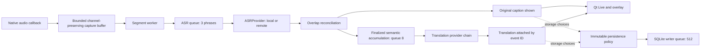

# Architecture

SubbyAI is a single-process PySide6 desktop app. The controller wires capture, processing,
storage and UI together. Audio, ASR, translation and storage are framework-free; Qt signals
carry immutable caption events from the pipeline to the UI. Each layer has a narrow contract and bounded work queues.

## Contracts

**Original captions never wait for translation.** A caption has a stable event ID, original
text and independent translation state. Later translation updates the same displayed and
persisted event. A slow or failed translator preserves the original. SQLite upserts and FTS
updates keep searchable history consistent without duplicating rows.

**Real-time work stays bounded.** The ring counts overwritten samples. ASR and translation
queues discard older pending work when full to stay near current playback. Metrics expose
queue depth, dropped work, wait time, ASR duration, translation duration and audio-end-to-caption
latency. Overload can omit speech; it cannot accumulate an unlimited backlog. The history
writer separately counts rejected writes when its bounded queue is full.

**Stop is a request, completion is an event.** The GUI never joins native inference workers.
The run owner joins them off the GUI thread, closes remote clients, then emits `stopped`.
A new run is refused while any old worker is alive, including after failure. Normal Stop drains
captured audio and final results; explicit cancellation suppresses late results. Device switching
waits for completion before reconnecting. A hung native
library cannot safely be killed from Python; shutdown continues waiting while the UI stays responsive.

**Each run receives frozen settings.** `SessionConfig` snapshots processing and provider
configuration. A Simple/Advanced toggle changes visibility, not engine state. Only an explicit
profile choice rewrites its underlying model, precision and phrase settings.

**Storage consent is enforced before the writer queue.** A policy removes excluded original
or translated text before any database operation. Session-only use has no database writes;
live-only first launches leave the database absent. Changing storage choices closes the old
history session and applies a fresh policy to subsequent events without restarting audio.

## Audio and subtitles

Capture callbacks copy native channels into blocks with rates, source offsets and continuity
epochs. Consumer workers downmix, continuously resample with anti-aliasing and segment 20 ms
frames using stateful bundled Silero VAD (adaptive energy is an observable fallback). Detector-only
gain helps quiet speech; model audio has no gain normalization or silence removal. Phrase completion
uses padded silence boundaries and a bounded maximum, retains preroll/overlap, and publishes actual
sample-based start/duration metadata. Driver gaps, format switches and buffer discontinuities reset
segmentation/context so unrelated audio is not joined. Normal Stop flushes subframe/resampler tails.
System sound and microphone are separate source kinds. Resolution and reconnect stay inside
the chosen kind. Device discovery polls on a worker, so PortAudio/CoreAudio enumeration never
blocks the UI. Unrelated device changes don't restart the active capture. A vanished selected
device pauses capture until it returns or the user chooses a replacement.

Whisper retains the stock decoder window, word timestamps and bounded finalized-text prompts.
Parakeet retains native timestamp tokens where supported. Forced-duration windows emit provisional
captions, then replace the same IDs after real acoustic lookahead; only finalized recognition enters
history, context or translation. This is window revision rather than token streaming.
`pipeline/reconciliation.py` aligns overlapping word times with conservative textual fallback,
including CJK text, while preserving deliberate repetition. Automatic language handling accumulates
longer evidence, stabilizes short fragments and permits switches on longer windows.
Hallucination filtering uses available recognition confidence; remote services without confidence
are treated as unknown rather than given fabricated scores.

Translation accumulates compatible finalized clauses within a bounded latency budget. A continuation
can replace an earlier fragment translation, with the whole translation attached once to its last
source caption. Text providers receive four recent sentence pairs, reset on language/continuity/long
gap changes; OPUS receives accumulated source sentences rather than fabricated prompt context.

Live overlay wrapping pages complete text through the line limit; corrections reset the page.
Static placement previews can still ellipsize. Its stable card width, minimum dwell and caption
history control readability. The overlay stores display preference and
geometry in logical coordinates; display removal restores an accessible placement.
Qt's Unicode line breaking preserves grapheme clusters; font merging supplies missing glyphs
from available system fonts. Saved appearance snapshots exclude display and session metadata.
One speech engine is cached across starts and released after the configurable idle timeout.
Loading and eviction share a lifecycle lock; live inference is never unloaded by the idle timer.

## Observable runtime state

Persisted preferences express intent. They do not claim a model is active or that a window is
visible. `SpeechState` publishes immutable Loading, Ready, Active and Failed snapshots from
the loader and pipeline; Live and Settings observe them on the GUI thread. Active starts only
after capture reaches Running. A selected model is displayed separately from a loaded model.
The cache releases old native weights before loading a replacement and attempts rollback on
failure, preserving one loaded local engine.

`ModelDownloads` owns one shared asynchronous installation job for the controller and settings.
Duplicate clicks observe the same job. Checking, Downloading, Cancelling, Cancelled, Verifying,
Installed and Error transitions include byte progress where available. Installation never changes
model selection. Only an explicit Start or Use action continues into loading after installation.
All required inference assets must exist. Pending/invalid markers prevent cancelled or failed
verification from being reported as installed; a failed integrity check forces a fresh retry.
Native Xet transfers cancel at Python file boundaries because progress callback exceptions cannot
interrupt the Rust transfer. The UI explains that the current transfer may finish first.

The controller strongly owns a parentless overlay window. Caption and translation events reach
both Live and the overlay on the GUI thread. `set_enabled` applies the preference immediately;
every visible caption wakes and maps the native window, including the default auto-hide mode.
Overlay state distinguishes Hidden, Starting, Downloading, Waiting, Visible, Idle, Error and
Placement preview. Overlay click feedback precedes asynchronous coalesced preference persistence.
Auto-hide
fades an existing window; it does not recreate it. Windows input transparency and topmost updates
use non-activating native flags. Text height changes preserve the bottom anchor, and screen/DPI
changes reflow and clamp geometry in logical coordinates. Debug logs record lifecycle, monitor
index, geometry and event IDs, without caption text or display names and without frame logging.

Explicit application shutdown closes the shell with its Quit intent after background cleanup.
Close-to-tray can therefore never veto Quit after the model and capture services have stopped.

## Modules and extension points

| Area | Responsibility |
|---|---|
| `core/settings.py`, `profiles.py` | Validated schema 4 settings, migrations, atomic saves, profile mappings |
| `core/network.py`, `logging_setup.py` | Endpoint validation, bounded replies, safe log formatting |
| `audio/` | Native capture blocks, downmix/resampling, VAD, segmentation, meter-only setup preview |
| `asr/base.py`, `engine.py`, `parakeet.py`, `remote.py` | Small ASRProvider contract and concrete engines |
| `asr/models.py`, `capability.py` | Curated revisions, downloads, cache integrity, isolated hardware probes |
| `translation/` | Provider chain, compatible text APIs, local CTranslate2 and validated packs |
| `pipeline/` | Run ownership, stage queues, timing, reconciliation and failure policy |
| `storage/` | Batched SQLite/FTS5 writer, retention, export and translation updates |
| `ui/` | Theme tokens, original Qt mascot, shell, Simple/Advanced settings, overlay and setup |
| `app.py`, `system/` | Cross-layer policy, tray, shortcuts, device recovery and single instance |

`ASRProvider` exposes load, transcribe and close with the existing result shape. The controller
chooses an engine; the GUI doesn't implement recognition. Translation has a separate provider
contract and an ordered chain with three-failure/60-second circuit breaking. See [providers.md](providers.md).

Local model cache keys include model, device, precision and CPU threads. One speech engine remains
warm across compatible runs; beam size is set per run. Local translation caches at most three
loaded pairs. At most two missing-pair installations run simultaneously, with a failure cooldown.
The lightweight pack manager removes Argos Python's unused PyTorch/Stanza dependency tree while
retaining its installed model format and direct CTranslate2/SentencePiece inference.

## Measurement and validation

Use real media and the live scalar diagnostics to assess latency on target hardware.
Physical Bluetooth, mixed-DPI, GPU and long-session checks complement automated tests.
See [accuracy-investigation.md](accuracy-investigation.md) for signal-level evidence, same-model
whole-file controls, repeatable replay tools, measured limitations and opt-in developer tracing.
